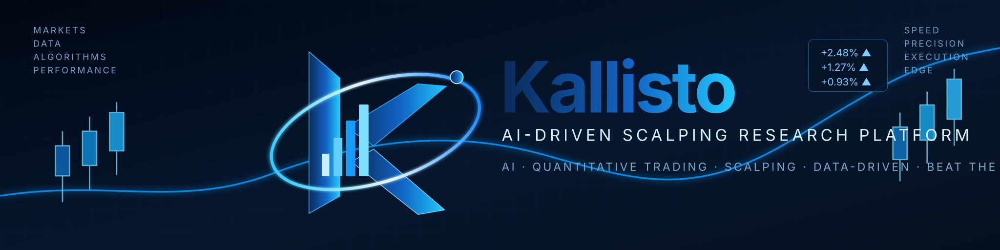
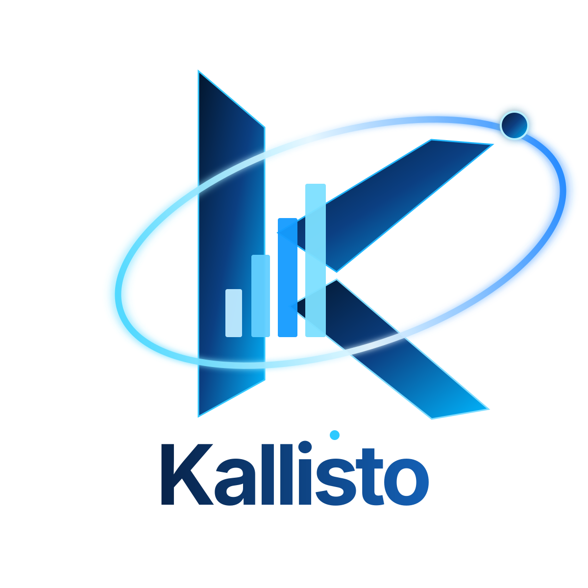
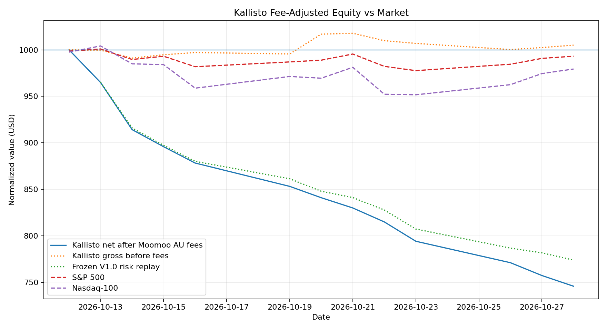
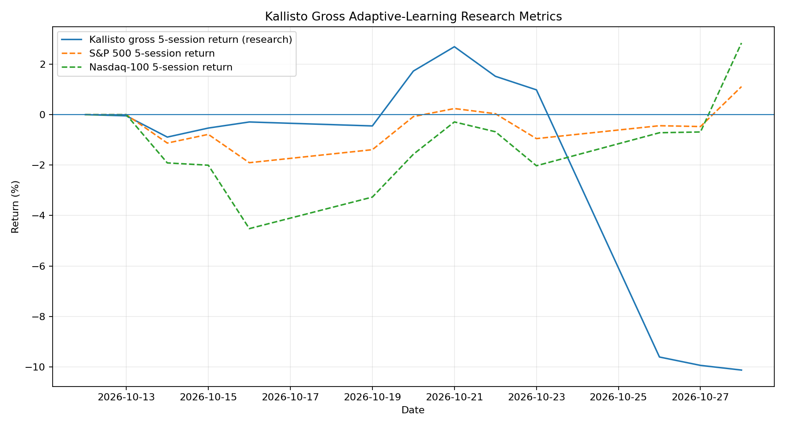
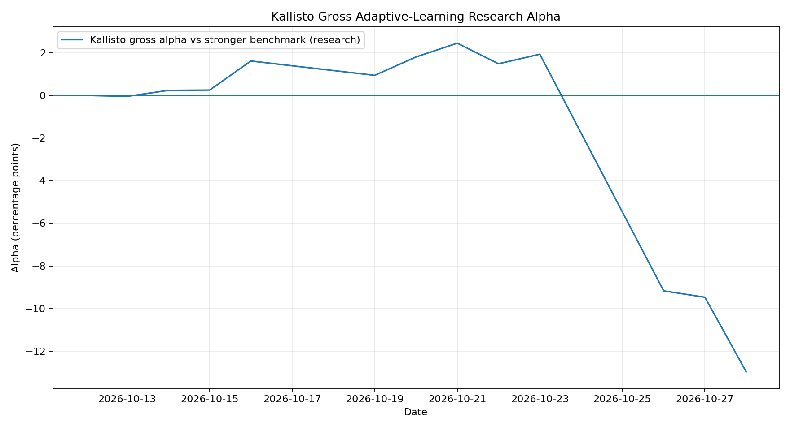

# Kallisto

**Kallisto** is a six-month, **simulation-only**, adaptive AI intraday scalping research platform. It tests whether an autonomous LLM-guided process can grow a $1,000 USD portfolio, improve through bounded self-evaluation, and outperform both the S&P 500 and Nasdaq-100.

<p align="center"></p>

> Kallisto does not place live orders or move real money. Moomoo Australia is the intended future broker-integration target, but the current platform remains a simulation.

## Original project and attribution

Kallisto is built on and inspired by **Nathan Smith / LuckyOne7777**:

- LLM-Investor-Behavior-Benchmark
- LLM-Trading-Lab

The original MIT license and copyright notice are retained.

## Research objective

> Can a fully autonomous LLM-guided intraday strategy, constrained by deterministic risk controls and a bounded learning loop, achieve positive simulated capital growth, improve over time, and outperform the S&P 500 and Nasdaq-100 over six months?

Positive returns, self-improvement and benchmark outperformance are research objectives, not guarantees.

## Kallisto V1 baseline

- Starting capital: **$1,000 USD**
- Clean Day 1: **the first complete Azure-hosted NYSE session after deployment**
- Oct 7-8 infrastructure attempts are excluded from the clean performance series
- No external deposits
- No leverage
- No options
- Whole shares only
- LONG and synthetic 1x SHORT trades allowed
- No overnight positions
- No manual trade approval

## Kallisto V1.1 fee-aware redesign

After transaction-cost modeling showed that V1.0's frequent low-dollar scalps were uneconomic at a $1,000 account size, Kallisto was versioned to **V1.1** rather than silently rewriting the original experiment.

V1.1 changes:
- risk per trade: **0.75%** of equity
- maximum open risk: **1.5%**
- maximum single-position size: **45%** of equity
- maximum simultaneous positions: **2**
- minimum confidence: **0.62**
- reward/risk floor: **2.0**
- minimum Titan target: **1.5%**
- minimum microcap target: **3.5%**
- minimum cash reserve: **20%**
- fee gate: expected gross target profit must be at least **1.5x modeled round-trip Moomoo AU fees**
- fee gate: expected net target profit must be at least **0.25% of current equity**

The **2% daily-loss breaker**, **10% portfolio drawdown pause**, no-leverage rule, no-options rule and same-day-flat rule remain unchanged.

The purpose is not simply to take larger risks. It is to **trade less often and require a materially larger expected payoff after fees**. Very low-priced microcaps may now be rejected entirely when per-share settlement costs make the trade uneconomic.

## Adaptive self-learning loop

Kallisto has a bounded self-evaluation layer. It does **not** retrain GPT weights. Instead, it learns by measuring its completed trades and market-relative performance, then allowing the evaluator to update a small allow-list of strategy parameters and prompt guidance within hard-coded safety ranges.

```text
market data
    ->
Kallisto LLM trade decisions
    ->
simulated trades
    ->
trade + daily performance logs
    ->
weekly evaluator
    ->
measured metrics + diagnosis
    ->
bounded parameter proposal
    ->
deterministic validation / safety ranges
    ->
new Kallisto strategy version (V1.1, V1.2, ...)
    ->
next trading period
```

The evaluator can tune only bounded items such as minimum confidence, per-trade risk within a narrow range, open-risk cap, exposure cap, position cap, cash reserve, reward/risk floor, maximum open positions, maximum holding time, minimum targets, and short evidence-based learning notes for the next prompt.

The evaluator **cannot** remove the daily loss breaker, drawdown pause, same-day flat rule, no-leverage rule, no-options rule, or the hard parameter bounds.

Learning cadence:

- measurement is updated daily
- self-evaluation runs every **5 completed NYSE sessions**
- the first review is after the first full trading week
- actual parameter changes cannot occur more often than every **10 completed sessions**
- a change also requires at least **20 completed trades** and evaluator confidence of **0.60 or higher**
- if evidence is weak, the evaluator records the review but makes **no change**
- every accepted change is versioned and written to `strategy_versions.csv`

Persistent adaptive files:

```text
adaptive_config.json
weekly_evaluations.jsonl
improvement_metrics.csv
strategy_versions.csv
baseline_replay.csv
```

The frozen `V1.0` risk replay provides a low-cost counterfactual control using the same realized trade sequence but the original V1 risk-sizing rules. This isolates risk-parameter changes. It is **not** a second independent LLM, so it does not fully isolate prompt-driven trade-selection changes.

<!-- ADAPTIVE_DASHBOARD_START -->
## Kallisto adaptive learning dashboard

> Simulation only. Headline P/L and equity below are net of modeled Moomoo Australia US-stock transaction fees. Adaptive-learning metrics remain separately identified when they are based on the gross simulator series.

| Metric | Current value |
|---|---:|
| Strategy version | **V1.1** |
| Completed sessions | 12 |
| Completed trades | 95 |
| **Kallisto net equity after modeled Moomoo AU fees** | **$745.99** |
| **Kallisto net cumulative return** | **-25.40%** |
| Simulator gross equity before fees | $1,005.01 |
| Simulator gross cumulative return | 0.50% |
| Gross trading P/L | $5.01 |
| Modeled Moomoo AU transaction fees | **$259.02** |
| Frozen V1.0 risk-replay equity | $774.07 |
| Frozen V1.0 risk-replay return | -22.59% |
| Gross simulator vs frozen V1.0 risk replay | 29.84% |
| S&P 500 return from experiment base | -0.69% |
| Nasdaq-100 return from experiment base | -2.06% |

### Fee treatment

- Moomoo AU commission: $0.
- Platform fee: $0.99 per order.
- Settlement fee: $0.003/share, capped at 1% of transaction amount.
- SEC fee: sells only, $0.0000206 × transaction amount, minimum $0.01/trade.
- FINRA TAF: $0/share under the current published Moomoo AU live fee schedule.
- CAT fee: NMS stocks $0.000003/share.
- Security-specific ADR custody and stock-borrow fees are included only when an applicable amount is supplied; Kallisto does not invent unknown fees.

### Beating-the-market and frozen-V1 graph



### Gross adaptive-learning research graphs





### Learning policy

- Evaluation cadence: every 5 completed NYSE sessions.
- First evaluation: after the first 5 completed sessions.
- Parameter changes: no more often than every 10 completed sessions.
- Evidence gate: at least 20 completed trades plus evaluator confidence of 0.60 or higher.
- Hard risk limits remain bounded in deterministic code; the evaluator cannot remove them.
- Every accepted change creates a new version (V1.1, V1.2, ...) and is recorded in `strategy_versions.csv`.
- The frozen V1.0 replay and adaptive-learning diagnostic series remain gross research controls so the historical experiment is not silently rewritten. They are not the headline P/L report.

<!-- ADAPTIVE_DASHBOARD_END -->

## Azure Functions runtime

Kallisto V1 uses **Azure Functions Flex Consumption as the trading clock**. The old GitHub Actions market scheduler is retired and manual-only.

```text
Azure timer around U.S. market hours
        ->
cheap New York-time guard
        ->
restore Kallisto state from Azure Blob Storage
        ->
NYSE calendar/time guard
        ->
5-minute market data + position monitoring
        ->
GPT-5.6 Luna decision when ~15-minute cadence is due
        ->
deterministic risk engine using current adaptive version
        ->
hypothetical LONG / SHORT execution
        ->
persist state + reports to Azure Blob Storage
        ->
function exits
```

The user's computer does not need to remain on once the Azure Function is deployed.

## Trading universe

Each trading day combines approximately the top **8 eligible microcaps by premarket volume** and top **8 available Nasdaq Titan candidates by premarket volume**.

Technical inputs include premarket volume/change, VWAP, EMA 9/20, RSI(14), MACD, ATR, relative volume and opening-range levels. Fundamental context may include market cap, float, beta, valuation, profitability, growth, leverage, ROE and short interest when available.

The LLM may only use supplied information and must not invent catalysts, Level 2 data, hidden order flow, proprietary signals or undisclosed news.

## Intraday timing

- monitoring begins around **09:25 ET**
- first entries allowed after **09:40 ET**
- LLM decision cadence: approximately **15 minutes**
- position monitoring cadence: approximately **5 minutes**
- no new entries after **15:30 ET**
- all remaining positions forced flat around **15:55 ET**

## Risk management

The LLM proposes ticker, direction, target, confidence and rationale. Deterministic code controls position size, stop distance, exposure and portfolio safety.

Core protections include per-trade risk budgeting, combined open-risk limit, gross exposure limit, single-position cap, cash reserve, daily-loss breaker, drawdown pause, maximum simultaneous positions, volatility stops, minimum reward/risk, breakeven protection, time-stop exits and forced end-of-day flat.

## Experiment state

During Azure execution the persistent source of truth is the Azure Blob container:

```text
scalping-v1-state/
  state/portfolio_state.json
  state/decision_log.jsonl
  state/trade_log.csv
  state/daily_performance.csv
  state/api_costs.csv
  state/adaptive_config.json
  state/weekly_evaluations.jsonl
  state/improvement_metrics.csv
  state/strategy_versions.csv
  state/baseline_replay.csv
  reports/results/...
```

A post-market GitHub Action refreshes README metrics and charts from Azure so the repository documents the live Kallisto experiment automatically.

## OpenAI API cost tracking

Every paid trading-decision call and weekly evaluator call records token usage and estimated USD cost in `api_costs.csv`.

<!-- API_COST_SUMMARY_START -->
| Cost period | API cost (USD) | API calls | Input tokens | Output tokens |
|---|---:|---:|---:|---:|
| Average daily | $0.0339 | 20.0 | 140,619 | 4,919 |
| Average weekly | $0.1357 | 80.0 | 562,476 | 19,678 |
| Average monthly | $0.4071 | 240.0 | 1,687,428 | 59,033 |
| **Total actual** | **$0.4071** | **240** | **1,687,428** | **59,033** |
<!-- API_COST_SUMMARY_END -->

OpenAI billing remains the source of truth for actual API charges.

## GitHub Actions

GitHub is used for source control, tests, deployment and post-market documentation refresh—not as the live market clock.

```text
.github/workflows/scalping-smoke-test.yml
.github/workflows/deploy-azure-function.yml
.github/workflows/refresh-adaptive-dashboard.yml
.github/workflows/daily-trading-experiment.yml   # legacy/manual only
```

## Live-transfer design for Moomoo Australia

Kallisto V1 is simulation only. A future broker connection must preserve the deterministic risk manager and add broker reconciliation, stale-data kill switches, execution-state checks, order idempotency, short eligibility, partial-fill handling and verified end-of-day flat status.

Exact simulated P/L is **not** assumed to transfer 1:1 to real money because live trading adds spreads, latency, queue position, partial fills, rejects, halts, short availability, borrow costs and market impact. Kallisto's headline simulation P/L now deducts the modeled published Moomoo AU US-stock transaction fees.

## Validation rule for Day 1

A day counts only if Azure actually executes market cycles. A legitimate zero-trade day is possible, but `decision_log.jsonl` must prove that the LLM evaluated eligible setups. A day with no decision records because the runtime failed does **not** count.

## Important limitations

- public/delayed market-data limitations
- 5-minute bars rather than tick/order-book data
- simplified slippage/fill assumptions
- no realistic partial-fill model yet
- no realistic short borrow/locate fee model yet
- no live broker reconciliation yet
- data-provider failures are possible
- LLM outputs can be wrong
- adaptation can overfit noise despite the evidence gates
- frozen V1 replay is a risk-control counterfactual, not a fully independent second LLM control arm

## License

Underlying LLM-Investor-Behavior-Benchmark code remains under its original MIT License.

Original copyright:

**Copyright (c) 2025 Nathan Smith**

---

**Product name:** Kallisto  
**Status:** Azure deployed; Day 1 complete; autonomous experiment running  
**Mode:** Simulation only  
**Starting capital:** $1,000 USD  
**Style:** Adaptive autonomous intraday scalping  
**Directions:** Long + synthetic unleveraged short  
**Benchmark objective:** Beat S&P 500 and Nasdaq-100 over six months  
**Duration:** 6 months
